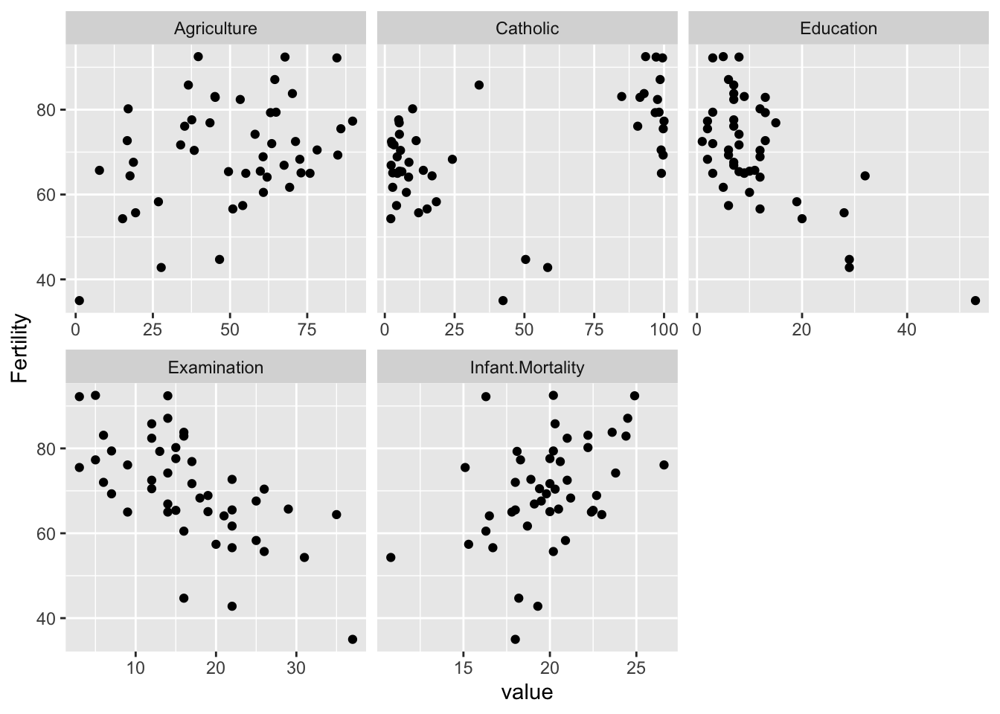

Consider a regression dataset with a response and several predictors. You want a single plot showing the response plotted against each of the predictors. You could use the pairs() but that also shows plots between the predictors. If there are more than a few predictors, there are too many plots to see any one of them clearly. Here’s a simple solution:

Here’s an example dataset:

``` r
head(swiss)
             Fertility Agriculture Examination Education Catholic
Courtelary        80.2        17.0          15        12     9.96
Delemont          83.1        45.1           6         9    84.84
Franches-Mnt      92.5        39.7           5         5    93.40
Moutier           85.8        36.5          12         7    33.77
Neuveville        76.9        43.5          17        15     5.16
Porrentruy        76.1        35.3           9         7    90.57
             Infant.Mortality
Courtelary               22.2
Delemont                 22.2
Franches-Mnt             20.2
Moutier                  20.3
Neuveville               20.6
Porrentruy               26.6
```

Now reorganise the data using the tidyr package so that there is one (x,y) pair on each line:

``` r
library(tidyr)
rdf <- gather(swiss, variable, value, -Fertility)
head(rdf)
  Fertility    variable value
1      80.2 Agriculture  17.0
2      83.1 Agriculture  45.1
3      92.5 Agriculture  39.7
4      85.8 Agriculture  36.5
5      76.9 Agriculture  43.5
6      76.1 Agriculture  35.3
```

Use ggplot2 to plot the response against each of the predictors (which are on different scales so we need to allow for that)

``` r
library(ggplot2)
ggplot(rdf, aes(x=value,y=Fertility)) + geom_point() + facet_wrap(~ variable, scale="free_x")
```

{width="672"}

We can elaborate as needed.
