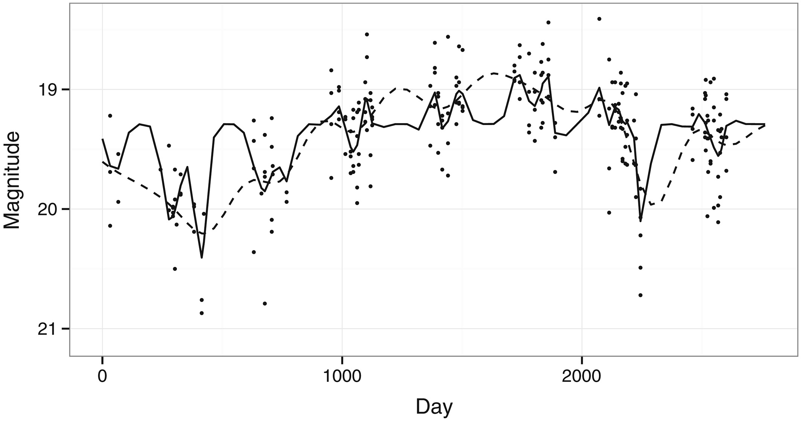

In [What’s wrong with simultaneous confidence bands](https://julianfaraway.github.io/post/what-s-wrong-with-simultaneous-confidence-bands){target="_blank" rel="noopener"}, I discussed the deficiencies of standard confidence bands, but how can we do better? Suppose we have a Gaussian process for the curve with some mean and a covariance kernel:

\$\$ k(x,x\^\\prime) = \\sigma\^2_f \\exp \\left( - {1 \\over 2l\^2} (x-x\^\\prime)\^2 \\right) + \\sigma\^2_n \\delta(x - x\^\\prime) \$\$

where δ is a delta function. The three hyper parameters, \$\\sigma_f, \\sigma_n\$ and \$l\$ control the appearance of the curve. We can put priors on these parameters along with a prior on the mean function and calculate the posterior using MCMC methods. The most important parameter \$l\$ controls the smoothness of the curve. We can view the uncertainty in this smoothness by computing a 95% credible interval for this parameter and plot the two curves corresponding to the endpoints of this interval. The other parameters are set at the posterior means. An example of these bands can be seen in the figure:

<figure id="figure-plot-of-smoothness-bands">

<figcaption>Plot of smoothness bands</figcaption>
</figure>

The solid line corresponds to the lower end of 95% interval for the smoothing parameter \$l\$ giving a rougher fit while the dashed line is the upper end of the interval which is a smoother fit. We are fairly sure that the correct amount of smoothness lies between these two limits.

Notice this makes a big difference to how many peaks and valleys we see in the function. The uncertainty about these features is more interesting than any uncertainty about the vertical position of the curve expressed by the traditional bands.

You can read all the details in my article: [Confidence bands for smoothness in nonparametric regression](https://julianfaraway.github.io/publication/confidence-bands/){target="_blank" rel="noopener"} and also view the [R code](https://people.bath.ac.uk/jjf23/scb/){target="_blank" rel="noopener"}.
