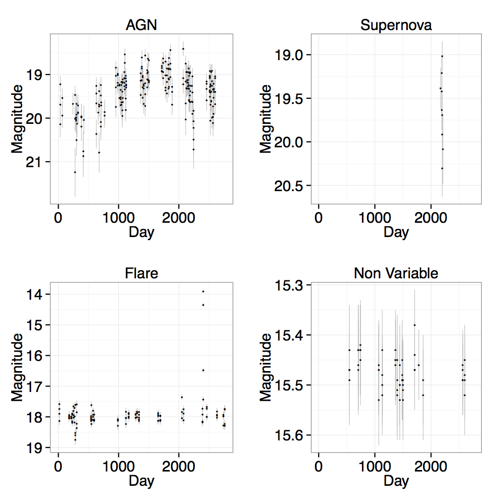

Sky surveys provide a wide-angle view of the universe. Instead of focusing on a single star or galaxy, they provide a snapshot of a wider portion of the sky. Their primary purpose is to search for asteroids, so they take a sequence of images over a short timespan: minutes or hours. By seeing what has changed, the asteroid can be detected. But meanwhile, much further away, other things are changing. Most objects in the night sky do not change much on human timescales, but some of the most interesting stars and galaxies are performing for us. As the survey returns to the same location from time to time, we can see those objects that have changed. But how do we detect and categorise these objects? Here is a plot of four such objects:

<figure id="figure-plot-of-light-curves">

<figcaption>Plot of light curves</figcaption>
</figure>

The first of the four is an example of an active galactic nucleus. The plot shows how the brightness of the object varies over time. The second plot shows a supernova – most of the time we see nothing because the galaxy is below the detection limit but briefly we see a spark of light for a few weeks. The third object is a flare – it’s mostly quiet but burst into life from time to time. The fourth object is like our sun – it varies a little but enough to be interesting (fortunately for us!).

These are examples of light curves. As technology improves, increasingly large numbers of these curves will be recorded. We need to quickly identify and categorise the interesting ones so that they can be rapidly followed up (before the show is over!). In [Modeling lightcurves for improved classification of astronomical objects](https://doi.org/10.1002/sam.11305){target="_blank" rel="noopener"}, we describe how this can be done. You can also read about it on [ArXiv](https://arxiv.org/abs/1401.3211){target="_blank" rel="noopener"} and examine the [software and data](https://people.bath.ac.uk/jjf23/modlc/){target="_blank" rel="noopener"}.
