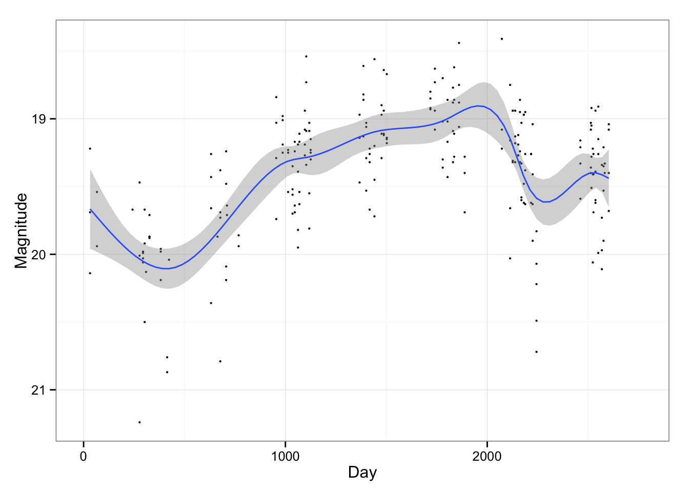
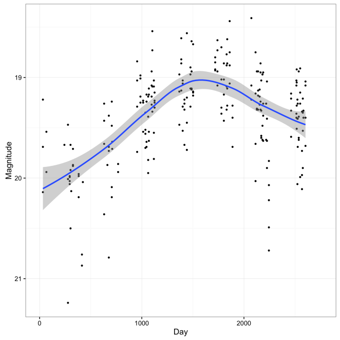

Here are some 95% confidence bands for a fitted curve shown on the same data. The first uses spline smoothing from the mgcv package while the second uses a loess smoother from the ggplot2 package.

<figure id="figure-plot-of-smoothness-bands-using-mgcv">

<figcaption>Plot of smoothness bands using mgcv</figcaption>
</figure>

<figure id="figure-plot-of-smoothness-bands-using-loess">

<figcaption>Plot of smoothness bands using loess</figcaption>
</figure>

If all you want is a graphical expression of the uncertainty in these two estimates, these are just fine. But suppose you want to check whether some proposed function fits entirely within the bands, then you will need to do more work. The bands above are pointwise meaning that the confidence statement is true at any given point but not true for the entire curve. For that, you will need simultaneous confidence bands. These are more work to produce and involve all sorts of intricate calculations. Hundreds of papers have been written on the topic because of the fascinating theoretical challenges it raises. I’m responsible for a few of these papers myself.

But are these bands really useful? Properly constructed, they may tell us there’s a 95% chance that the bands capture the true curve. But what is the value in that? There will be some users who are interested in replacing the smooth fit with some particular parametric form, say a quadratic. Such users would be better off embedding their search within a family of increasingly complex alternatives and choosing accordingly. SCBs would not be an efficient strategy.

In SCB papers that have a data example, the usual motivation is that the user is interested in whether some particular feature exists, say a secondary maximum, for example. But users looking for particular features are better off with a method designed to look for those features, such as SiZer.

The greatest uncertainty is demonstrated by comparing the two figures above. How much smoothing should be applied? This makes a crucial difference to our interpretation. In the typical SCB construction, the amount of smoothing is chosen by some algorithm and the bands only reflect the uncertainty in the amplitude of the curves.

We need bands that tell us about the uncertainty in the smoothing. I will explain how to do this in the next [blog post](https://julianfaraway.github.io/post/confidence-bands-for-smoothness){target="_blank" rel="noopener"}.
